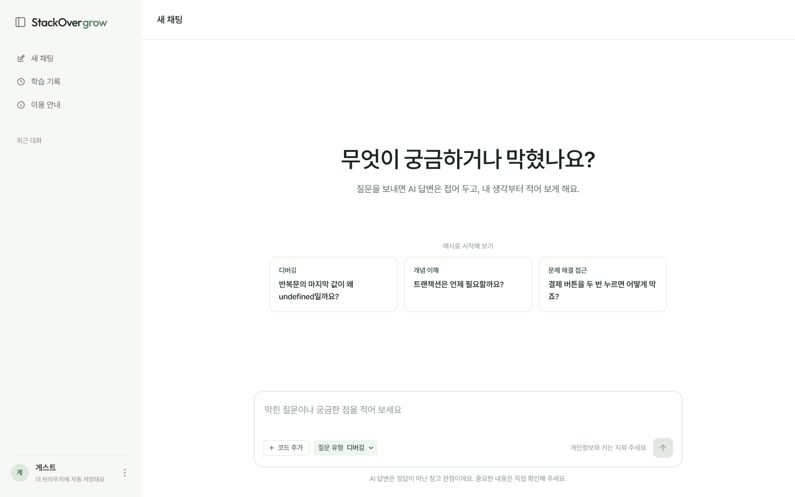
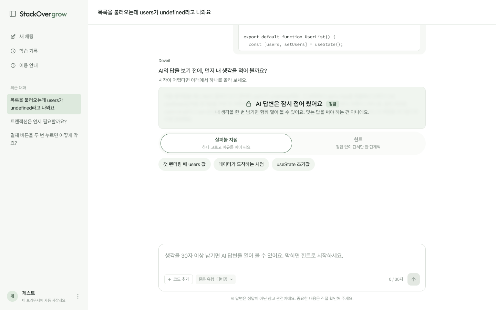
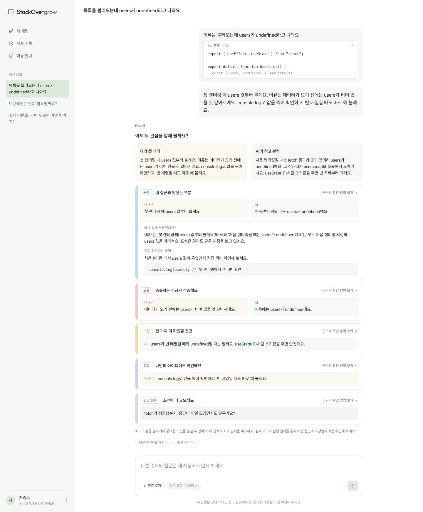
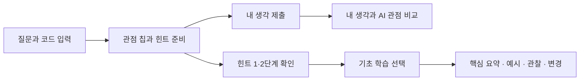
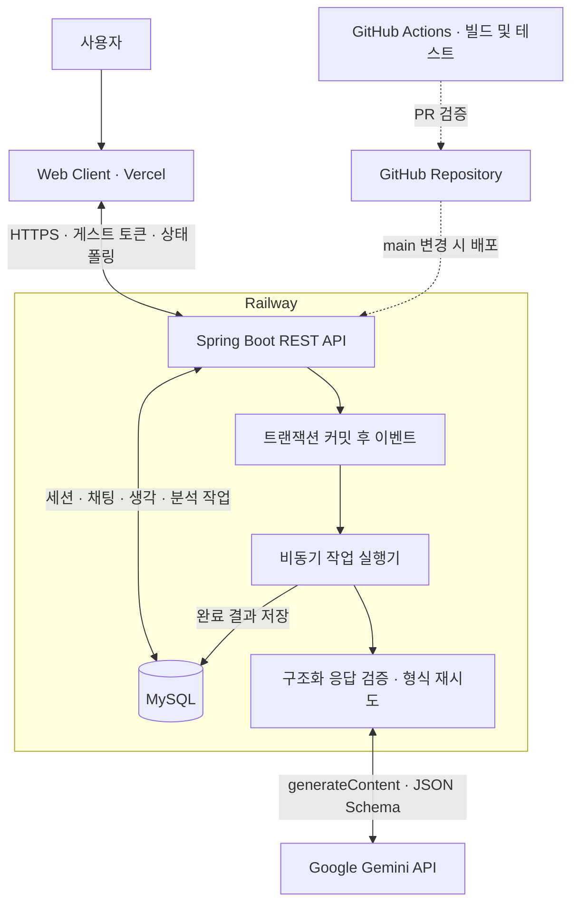

<div align="center">

# StackOverGrow

### AI의 답을 보기 전에, 나의 생각부터.

질문하고 · 생각하고 · 비교하며 배우는 개발 학습 서비스


**1호선톤 6팀 · Backend Repository**

</div>

---

## About

AI의 설명을 읽으면 이해한 것 같지만, 같은 문제를 혼자 설명하거나 다시 해결하기는 어려울 때가 있습니다.

**StackOverGrow는 답을 확인하기 전에 자신의 예상과 근거를 남기고, AI의 참고 관점과 비교하며 학습하는 서비스입니다.** 개발 질문과 코드를 입력하면 생각을 시작할 관점과 단계별 힌트를 제공합니다. 이후 내 생각을 비교하거나, 기초 설명과 예시부터 학습하는 경로를 선택할 수 있습니다.

이 저장소는 게스트 세션, 채팅과 잠금 상태, LLM 연동, 비교 분석 및 기초 학습 API를 담당합니다.

## Demo

[StackOverGrow 서비스 바로가기](https://stackovergrow.vercel.app/)

## Screenshots

### 01. 질문으로 시작하기

질문 유형을 선택하고 궁금한 내용과 코드를 입력합니다.



### 02. 답을 보기 전에 내 생각 남기기

AI 답변은 잠시 접어 두고, 살펴볼 지점이나 힌트를 참고해 먼저 생각을 적습니다.



### 03. 두 관점 비교하기

내 생각과 AI의 참고 관점을 나란히 보고, 비교 카드의 근거와 확인 방법을 살펴봅니다.



## Key Features

| 기능 | 설명 |
| --- | --- |
| **질문 유형별 학습** | 개념 이해, 디버깅, 문제 해결 접근, 설계 판단의 네 유형으로 질문합니다. 코드도 함께 입력할 수 있습니다. |
| **답변 잠금과 생각 제출** | AI 답을 보기 전에 자신의 예상·이유·확인 방법을 남깁니다. |
| **살펴볼 지점** | 질문에 맞는 서로 다른 관점을 1~3개의 칩으로 제공해 생각의 시작을 돕습니다. |
| **단계별 힌트** | 정답을 직접 공개하지 않고, 두 단계의 힌트를 차례로 제공합니다. |
| **비교 분석** | 사용자 생각을 인용하고 공통·오류·보완·고유·판단 보류로 나누어 AI 관점 및 근거를 제공합니다. 분류별 항목은 내용에 따라 달라집니다. |
| **기초 학습** | 두 단계의 힌트를 본 뒤, 핵심 요약·예시 코드·관찰·변경 활동으로 기초부터 살펴볼 수 있습니다. |
| **게스트 학습 기록** | 회원가입 없이 게스트 세션으로 이용하며, 해당 세션의 최근 대화와 학습 결과를 조회·삭제합니다. |

### 두 가지 학습 경로



한 채팅에서는 비교 분석과 기초 학습 중 하나의 경로를 진행합니다. 비교 결과를 확인한 뒤 같은 채팅에서 기초 학습으로 전환하지 않습니다.

> AI의 답변과 분류는 정답이 아닌 참고 관점입니다. 중요한 내용은 코드 실행과 추가 확인을 통해 검증합니다.

## Tech Stack

| 구분 | 기술 | 사용 목적 |
| --- | --- | --- |
| Language | **Java 21** | 백엔드 애플리케이션 |
| Framework | **Spring Boot 4.1.2 · Spring MVC** | REST API, 요청 검증, 공통 예외 처리 |
| Persistence | **Spring Data JPA · Hibernate** | 엔티티와 트랜잭션, 채팅·분석 상태 저장 |
| Database | **MySQL 8.x · H2** | 운영·로컬 데이터 저장 / 테스트용 인메모리 DB |
| LLM | **Gemini 3.6 Flash · RestClient** | 관점·힌트·기준 답변 선생성, 비교 분석, 기초 설명 |
| JSON | **Jackson 3** | 구조화 응답 파싱·검증 |
| API Docs | **springdoc-openapi 3.2.0 · Swagger UI** | API 명세와 요청 테스트 |
| Test & Build | **JUnit Jupiter · AssertJ · Gradle 9.8.2** | 단위·통합 테스트와 빌드 |
| CI/CD | **GitHub Actions · Railway** | PR 빌드·테스트, 백엔드 배포 |
| Web Hosting | **Vercel** | 프론트엔드 배포 |

모델은 `main`의 기본 설정을 기준으로 표기했습니다. 배포 환경의 모델 설정은 환경변수로 변경할 수 있습니다.

## System Architecture



질문을 저장한 뒤 트랜잭션 커밋 이후에 비동기 선생성을 실행합니다. 생각 제출 또는 기초 학습 선택도 별도 분석 작업으로 처리하고, 프론트엔드는 상태 조회 API를 폴링해 완료 결과를 받습니다.

### Technical Highlights

| 구현 포인트 | 설명 |
| --- | --- |
| **비동기 LLM 처리** | `@Async`와 커밋 후 이벤트로 모델 호출을 요청 트랜잭션에서 분리합니다. |
| **잠금 상태와 중복 요청 제어** | 채팅 행 잠금과 DB 유일 제약으로 같은 채팅의 중복 분석 및 서로 다른 학습 경로의 충돌을 제어합니다. |
| **구조화 응답 검증** | Gemini에 JSON Schema를 전달하고, 파서에서 필수 필드·타입·배열 개수 등을 다시 검사합니다. 형식 오류는 수정 지시와 함께 최초 호출 포함 최대 3회 처리합니다. |
| **원문 인용 검증** | 비교 카드의 인용이 사용자 생각에 실제로 있는지 공백 차이를 정규화해 검사하고, 원문에 없는 인용 항목은 제외합니다. |
| **실패 처리와 관측** | 호출당 15초 제한을 적용하고, 호출 유형·모델·프롬프트 버전·토큰·소요 시간·결과를 기록합니다. API 오류와 시간 초과는 자동 재호출하지 않습니다. |
| **게스트 소유권 확인** | `X-Guest-Token`으로 세션을 식별해 해당 세션의 채팅만 조회·수정합니다. |

## Project Structure

```text
line1thon_6_BE/
├── config/                         # 로컬 설정 예시
├── docs/                           # DB · 출력 스키마 · 오류 · 배포 문서
├── src/main/java/com/line1thon/team6/
│   ├── session/                    # 게스트 세션 발급 · 토큰 · 소유권 확인
│   ├── chat/                       # 질문 · 생각 · 힌트 · 대화 목록 · 잠금 상태
│   ├── analysis/                   # 분석 조회 · 재시도 · 기초 학습 API와 작업 상태
│   ├── ai/
│   │   ├── client/                 # Gemini 호출과 가짜 LLM 클라이언트
│   │   ├── prepare/                # 관점 칩 · 힌트 · 기준 답변 선생성
│   │   ├── analysis/               # 비교 분석 · 기초 설명 프롬프트와 결과 파서
│   │   ├── service/                # 구조화 호출 · 형식 수정 · 사용량 기록
│   │   ├── config/                 # 모델 · 호출 설정
│   │   ├── entity/                 # LLM 사용량 엔티티
│   │   ├── repository/             # LLM 사용량 저장소
│   │   └── exception/              # LLM 오류 정의
│   ├── global/                     # 공통 설정 · 예외 · 시간 · 요청 추적
│   └── Team6Application.java
├── src/main/resources/
│   ├── prompts/                    # 비교 · 기초 · 보안 프롬프트 원문
│   └── application*.properties     # 환경별 설정
├── src/test/                       # 단위 · API · 통합 테스트
└── .github/workflows/ci.yml        # 빌드 · 테스트 자동화
```

## API Documentation

- [Swagger UI](https://line1thon6be-production.up.railway.app/swagger-ui/index.html)
- [DB 스키마](docs/db-schema.md) · [LLM 출력 스키마](docs/ai/output-schemas.md) · [오류 코드](docs/error-codes.md)
- [배포 문서](docs/deploy.md) · [개발·협업 규칙](docs/development.md)

Swagger에서 `POST /api/sessions`로 게스트 토큰을 발급받은 뒤, **Authorize**에 입력하면 인증이 필요한 API를 호출할 수 있습니다.

## Team & Roles

**1호선톤 6팀 · 백엔드 및 LLM 연동 담당**

| 이름 | 역할 | 담당 |
| --- | --- | --- |
| [김다은](https://github.com/nutdaeun) | Backend A | 게스트 세션, 질문·생각 저장 및 검증, 잠금 상태 관리, 대화 조회·복구 |
| [문효재](https://github.com/hyojae02) | Backend B | LLM 연동, 비동기 선생성·분석, 힌트·기초 학습 API, 출력 검증·재시도·운영 로그 |
| [이유주](https://github.com/dailyhm) | AI | 선생성·비교·기초 학습 프롬프트, 출력 JSON 스키마, 평가셋 및 결과 품질 검증 |
