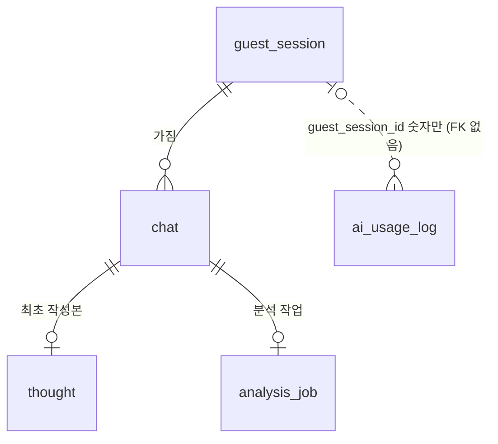

# DB 스키마

> - API 명세서, 잠금 상태 머신, 11/7 회의 결정을 기준으로 만든 초안입니다.
> - MySQL 8 기준입니다. enum 값은 VARCHAR로 저장하고 JPA에서 `@Enumerated(EnumType.STRING)`으로 매핑합니다.
> - 채팅을 가리키는 테이블은 모두 FK `ON DELETE CASCADE`라서, 대화 삭제와 전체 삭제는 `chat` / `guest_session` 행 하나만 지우면 됩니다. AI 사용 기록은 채팅과 연결하지 않고, FK 없이 `guest_session_id`만 숫자로 저장합니다.

## ERD



## 테이블 목록

| 테이블 | 담당 | 내용 |
| --- | --- | --- |
| `guest_session` | A | 게스트 토큰 |
| `chat` | A | 질문, 잠금 상태, 선생성 결과(칩·힌트·기준 답변) |
| `thought` | A | 생각 최초 작성본 (채팅당 1개, 수정 불가) |
| `analysis_job` | A | 비교 분석 / 기초 설명 작업과 결과 (채팅당 1개). 결과 저장은 B의 분석 리스너가 함 |
| `ai_usage_log` | B | AI 호출 기록 (FK 없음) |

## 테이블 상세

### guest_session

| 컬럼 | 타입 | 제약 | 설명 |
| --- | --- | --- | --- |
| id | BIGINT | PK, AUTO_INCREMENT |  |
| token | CHAR(36) | NOT NULL, UNIQUE | 헤더 `X-Guest-Token` 값 (UUID) |
| user_id | BIGINT | NULL | 나중에 로그인 붙일 때를 위한 자리. MVP에서는 항상 NULL |
| created_at | DATETIME(6) | NOT NULL |  |

### chat

| 컬럼 | 타입 | 제약 | 설명 |
| --- | --- | --- | --- |
| id | BIGINT | PK, AUTO_INCREMENT | chatId |
| guest_session_id | BIGINT | NOT NULL, FK → guest_session CASCADE | 소유자 |
| client_request_id | CHAR(36) | NOT NULL | 중복 전송 방지 |
| type | VARCHAR(20) | NOT NULL | CONCEPT / DEBUGGING / PROBLEM_SOLVING / DESIGN |
| example_id | VARCHAR(40) | NULL | 예시 질문 카드로 보낸 경우 |
| question | TEXT | NOT NULL | 최대 2,000자 |
| code | TEXT | NULL | 최대 6,000자, 비밀값은 `[REDACTED]`로 바꿔 저장 |
| secret_masked | BOOLEAN | NOT NULL, DEFAULT FALSE |  |
| status | VARCHAR(20) | NOT NULL, DEFAULT 'LOCKED' | LOCKED / UNLOCKED_SELF / UNLOCKED_ASSISTED. LockService에서만 변경 |
| prepare_status | VARCHAR(20) | NOT NULL, DEFAULT 'PREPARING' | PREPARING / DONE / FAILED |
| prepare_started_at | DATETIME(6) | NOT NULL | 선생성 시작(재시도 포함) 시각. 1분 넘게 PREPARING이면 FAILED 처리할 때 사용 |
| hint_level | TINYINT | NOT NULL, DEFAULT 0 | 0~2 |
| choices | JSON | NULL | 칩 3개 `["...", "...", "..."]` |
| hints | JSON | NULL | 힌트 2단계 `["힌트1", "힌트2"]`. 힌트 기록 테이블은 만들지 않음 |
| reference_answer | TEXT | NULL | 기준 답변. `status`가 `UNLOCKED_*`일 때만 응답에 포함 |
| created_at | DATETIME(6) | NOT NULL |  |
| updated_at | DATETIME(6) | NOT NULL |  |

- UNIQUE (`guest_session_id`, `client_request_id`): 같은 전송 ID로 두 번 와도 채팅이 하나만 생김
- INDEX (`guest_session_id`, `created_at`): 최근 대화 목록 (사용량 제한을 나중에 만들면 하루 30회 확인에도 사용)

### thought

| 컬럼 | 타입 | 제약 | 설명 |
| --- | --- | --- | --- |
| id | BIGINT | PK, AUTO_INCREMENT |  |
| chat_id | BIGINT | NOT NULL, UNIQUE, FK → chat CASCADE | 채팅당 1개 |
| content | TEXT | NOT NULL | 30~2,000자. 저장 후 수정하지 않음 |
| selected_choice | TINYINT | NULL | 0~2, 기록용 |
| hint_used | BOOLEAN | NOT NULL | 제출 시점의 `hint_level > 0` |
| created_at | DATETIME(6) | NOT NULL |  |

### analysis_job

| 컬럼 | 타입 | 제약 | 설명 |
| --- | --- | --- | --- |
| id | BIGINT | PK, AUTO_INCREMENT | jobId |
| chat_id | BIGINT | NOT NULL, UNIQUE, FK → chat CASCADE | 채팅당 1개 |
| mode | VARCHAR(10) | NOT NULL | COMPARE / BASIC. 생성할 때 저장 |
| status | VARCHAR(10) | NOT NULL, DEFAULT 'PENDING' | PENDING / DONE / FAILED |
| attempt_count | TINYINT | NOT NULL, DEFAULT 1 | 첫 시도 포함 최대 3. `remainingRetries = 3 - attempt_count` |
| error_code | VARCHAR(30) | NULL | AI_TIMEOUT / AI_INVALID_JSON / AI_API_ERROR |
| findings | JSON | NULL | COMPARE 결과 항목 배열. `[{category, title, detail, userQuote, followUpQuestion}]`, AI가 준 순서 그대로 |
| basic_explanation | TEXT | NULL | BASIC일 때만 |
| is_demo | BOOLEAN | NOT NULL, DEFAULT FALSE | 저장된 예시 응답 여부 |
| created_at | DATETIME(6) | NOT NULL |  |
| completed_at | DATETIME(6) | NULL | DONE이 된 시각 |

- `chat_id` UNIQUE로 "진행 중인 작업 최대 1개"를 DB에서도 보장해요. 즉, 한 채팅에 분석 작업 행이 두 개 생기는 걸 DB가 직접 막음. 정지 기능을 빼기로 해서 작업이 취소될 일이 없고, 재시도는 같은 행을 다시 PENDING으로 돌리므로 채팅당 작업은 평생 1개예요. 동시에 두 번 제출해도 두 번째 INSERT가 실패해요.
- 비교 항목은 따로 가리킬 일이 없어서(판정 이의 제기 제외) 별도 테이블 없이 `findings` JSON 하나로 저장해요. 재시도에 성공하면 통째로 덮어써요. 응답의 `findings[].id`는 배열 순서(0, 1, 2...)로 대신하거나 빼면 돼요.

### feedback (MVP 제외)

(추후)

| 컬럼 | 타입 | 제약 | 설명 |
| --- | --- | --- | --- |
| id | BIGINT | PK, AUTO_INCREMENT | feedbackId |
| chat_id | BIGINT | NOT NULL, FK → chat CASCADE |  |
| finding_index | TINYINT | NULL | `analysis_job.findings` 배열 순서. NULL이면 결과 전체에 대한 의견 |
| content | VARCHAR(1000) | NOT NULL |  |
| created_at | DATETIME(6) | NOT NULL |  |

### ai_usage_log

| 컬럼 | 타입 | 제약 | 설명 |
| --- | --- | --- | --- |
| id | BIGINT | PK, AUTO_INCREMENT |  |
| guest_session_id | BIGINT | NULL, FK 없음 | 사용자별 기록 조회용. 대화나 세션을 지워도 기록은 남김 |
| request_id | VARCHAR(40) | NOT NULL |  |
| call_type | VARCHAR(10) | NOT NULL | PREPARE / COMPARE / BASIC |
| model | VARCHAR(50) | NOT NULL |  |
| prompt_version | VARCHAR(20) | NOT NULL |  |
| input_tokens | INT | NULL |  |
| output_tokens | INT | NULL |  |
| latency_ms | INT | NULL |  |
| result | VARCHAR(10) | NOT NULL | SUCCESS / FAILED |
| error_code | VARCHAR(30) | NULL |  |
| created_at | DATETIME(6) | NOT NULL |  |

- 질문, 코드, 생각, AI 응답 원문은 넣지 않아요 (공통 규칙의 로그 정책).

## DDL

```sql
CREATE TABLE guest_session (
  id          BIGINT AUTO_INCREMENT PRIMARY KEY,
  token       CHAR(36)    NOT NULL,
  user_id     BIGINT      NULL,
  created_at  DATETIME(6) NOT NULL,
  CONSTRAINT uk_guest_session_token UNIQUE (token)
);

CREATE TABLE chat (
  id                     BIGINT AUTO_INCREMENT PRIMARY KEY,
  guest_session_id       BIGINT       NOT NULL,
  client_request_id      CHAR(36)     NOT NULL,
  type                   VARCHAR(20)  NOT NULL,
  example_id             VARCHAR(40)  NULL,
  question               TEXT         NOT NULL,
  code                   TEXT         NULL,
  secret_masked          BOOLEAN      NOT NULL DEFAULT FALSE,
  status                 VARCHAR(20)  NOT NULL DEFAULT 'LOCKED',
  prepare_status         VARCHAR(20)  NOT NULL DEFAULT 'PREPARING',
  prepare_started_at     DATETIME(6)  NOT NULL,
  hint_level             TINYINT      NOT NULL DEFAULT 0,
  choices                JSON         NULL,
  hints                  JSON         NULL,
  reference_answer       TEXT         NULL,
  created_at             DATETIME(6)  NOT NULL,
  updated_at             DATETIME(6)  NOT NULL,
  CONSTRAINT fk_chat_guest FOREIGN KEY (guest_session_id)
    REFERENCES guest_session (id) ON DELETE CASCADE,
  CONSTRAINT uk_chat_request UNIQUE (guest_session_id, client_request_id),
  INDEX idx_chat_guest_created (guest_session_id, created_at)
);

CREATE TABLE thought (
  id               BIGINT AUTO_INCREMENT PRIMARY KEY,
  chat_id          BIGINT      NOT NULL,
  content          TEXT        NOT NULL,
  selected_choice  TINYINT     NULL,
  hint_used        BOOLEAN     NOT NULL,
  created_at       DATETIME(6) NOT NULL,
  CONSTRAINT uk_thought_chat UNIQUE (chat_id),
  CONSTRAINT fk_thought_chat FOREIGN KEY (chat_id)
    REFERENCES chat (id) ON DELETE CASCADE
);

CREATE TABLE analysis_job (
  id                 BIGINT AUTO_INCREMENT PRIMARY KEY,
  chat_id            BIGINT      NOT NULL,
  mode               VARCHAR(10) NOT NULL,
  status             VARCHAR(10) NOT NULL DEFAULT 'PENDING',
  attempt_count      TINYINT     NOT NULL DEFAULT 1,
  error_code         VARCHAR(30) NULL,
  findings           JSON        NULL,
  basic_explanation  TEXT        NULL,
  is_demo            BOOLEAN     NOT NULL DEFAULT FALSE,
  created_at         DATETIME(6) NOT NULL,
  completed_at       DATETIME(6) NULL,
  CONSTRAINT uk_job_chat UNIQUE (chat_id),
  CONSTRAINT fk_job_chat FOREIGN KEY (chat_id)
    REFERENCES chat (id) ON DELETE CASCADE
);

CREATE TABLE ai_usage_log (
  id              BIGINT AUTO_INCREMENT PRIMARY KEY,
  guest_session_id BIGINT     NULL,
  request_id      VARCHAR(40) NOT NULL,
  call_type       VARCHAR(10) NOT NULL,
  model           VARCHAR(50) NOT NULL,
  prompt_version  VARCHAR(20) NOT NULL,
  input_tokens    INT         NULL,
  output_tokens   INT         NULL,
  latency_ms      INT         NULL,
  result          VARCHAR(10) NOT NULL,
  error_code      VARCHAR(30) NULL,
  created_at      DATETIME(6) NOT NULL,
  INDEX idx_usage_guest (guest_session_id, created_at)
);
```

## 설계 메모

- **A - 선생성 결과를 `chat`에 둔 이유**: 칩·힌트·기준 답변은 채팅당 한 세트이고 같이 생겨서, 테이블을 나누면 조인만 늘어요. 힌트는 회의에서 기록 테이블을 만들지 않기로 해서 JSON 배열로 저장해요.
- **B - 삭제 방식 (DB cascade로 확정)**: 채팅에 딸린 행(`thought`, `analysis_job`)은 JPA가 아니라 DB의 `ON DELETE CASCADE`가 지워요. 코드에서는 `chat` 행 하나만 지우고, `Chat` 엔티티에 `@OneToMany(cascade = REMOVE)`나 `orphanRemoval`을 달지 않아요. 자식 엔티티(`Thought.chat`, `AnalysisJob.chat`)에는 `@OnDelete(action = OnDeleteAction.CASCADE)`를 붙여서 `ddl-auto`로 만들 때도 FK에 cascade가 들어가게 해요.
- **A - 동시성**: 생각 제출과 기초 학습 전환이 동시에 와도 `analysis_job.chat_id` UNIQUE 때문에 하나만 성공해요. 잠금 상태 머신 문서의 `SELECT ... FOR UPDATE`와 같이 쓰면 친절한 409 응답까지 줄 수 있어요.

### 추후 구현 항목

- **사용량 제한**: 추후 구현. 만들 때도 테이블은 필요 없어요. 게스트당 하루 횟수는 `chat`에서 오늘 만든 행 수로 세고, IP당 횟수는 서버 메모리에서 세면 돼요.
- **배운 점 한 줄(회고)**: 추후 구현이라 MVP 스키마에서 뺐어요. 만들 때는 대화당 1개, 덮어쓰기라 `chat`에 `reflection` 컬럼을 추가하면 돼요.

## 확인할 것

- [x] DB 종류 (MySQL 8 가정)
- [ ] B: `analysis_job` 결과 컬럼(`error_code`, `findings`, `basic_explanation`)과 `ai_usage_log` 컬럼이 B 구현과 맞는지
